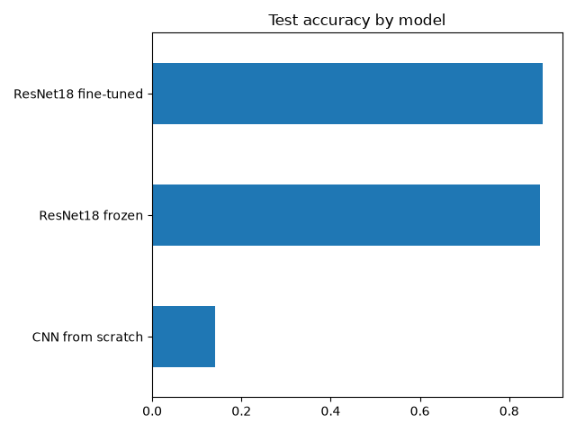
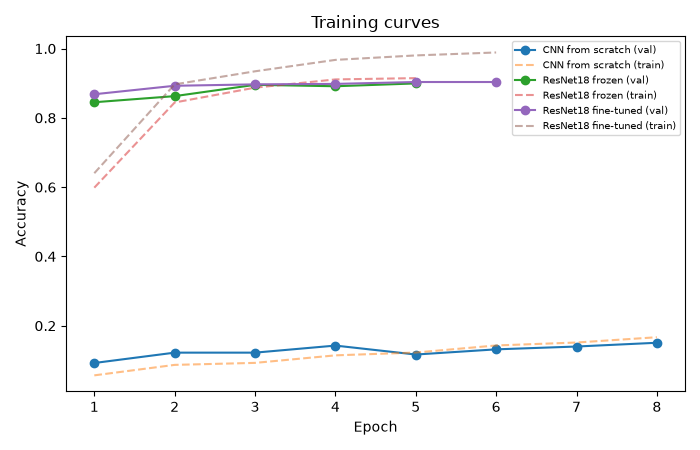
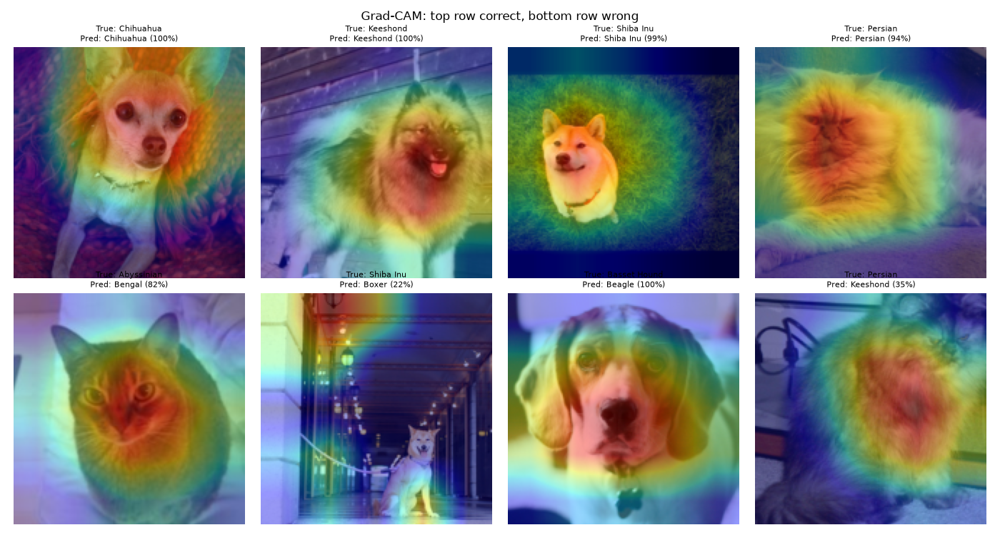

# Pet Breed Classifier (Transfer Learning + Grad-CAM)

Classifies 37 cat and dog breeds from photos using PyTorch. Compares a CNN trained from scratch against transfer learning with ResNet18, explains predictions with Grad-CAM, and serves them through a Streamlit app.

## What I did
- Used the Oxford-IIIT Pet dataset with a stratified 80/20 train/validation split and a separate test set (3,669 images)
- Applied data augmentation (random resized crop, flip, color jitter) to reduce overfitting
- Trained a small CNN from scratch as a baseline
- Compared ResNet18 feature extraction (frozen backbone) with fine-tuning the last block using differential learning rates and cosine decay
- Kept the epoch with the best validation accuracy and touched the test set only once
- Analysed confusions between similar breeds and visualised model attention with Grad-CAM
- Built a Streamlit app with top-5 predictions, a heatmap and a low-confidence warning

## Results (test set)
| Model | Accuracy | Top-5 accuracy | Macro-F1 |
|---|---|---|---|
| CNN from scratch | 0.140 | 0.437 | 0.114 |
| ResNet18 frozen | 0.869 | 0.991 | 0.868 |
| ResNet18 fine-tuned | 0.876 | 0.989 | 0.874 |

Transfer learning improved accuracy from 14% to about 88% compared with training a small CNN from scratch on the same data.

## Error analysis
Most confused breeds (true -> predicted : count):
- Staffordshire Bull Terrier -> American Pit Bull Terrier : 25
- Ragdoll -> Birman : 18
- Birman -> Ragdoll : 18
- American Pit Bull Terrier -> Staffordshire Bull Terrier : 14
- American Pit Bull Terrier -> American Bulldog : 13

Weakest breeds by recall: Staffordshire Bull Terrier (0.46) and American Pit Bull Terrier (0.54). These breeds look almost identical even to humans, so the errors are understandable.

## How to run
pip install -r requirements.txt
python train.py
streamlit run app.py

## Limitations
- Trained on 160px images on a CPU to keep training fast; higher resolution and a bigger backbone would improve accuracy
- Only knows 37 breeds; any other image still gets a breed (the low-confidence warning only partly helps)
- Small fine-grained dataset; some breeds are nearly indistinguishable
- Single training run without multiple seeds, so the small gap between frozen (0.869) and fine-tuned (0.876) may be noise

## Tech stack
Python, PyTorch, torchvision, scikit-learn, matplotlib, Streamlit